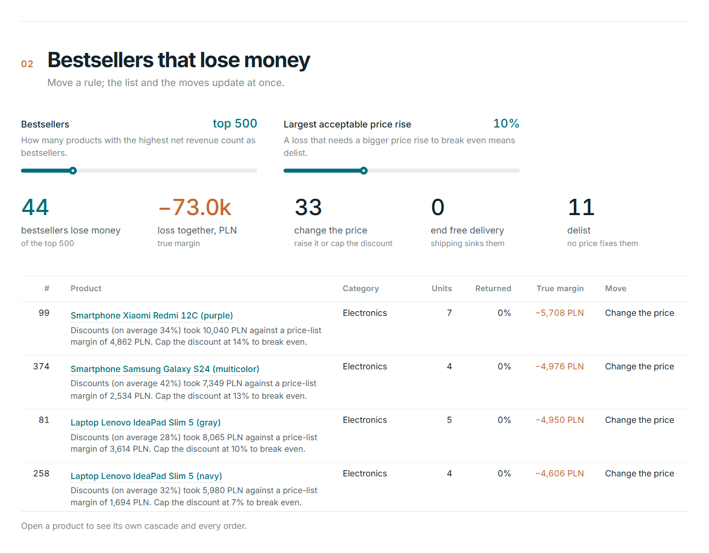
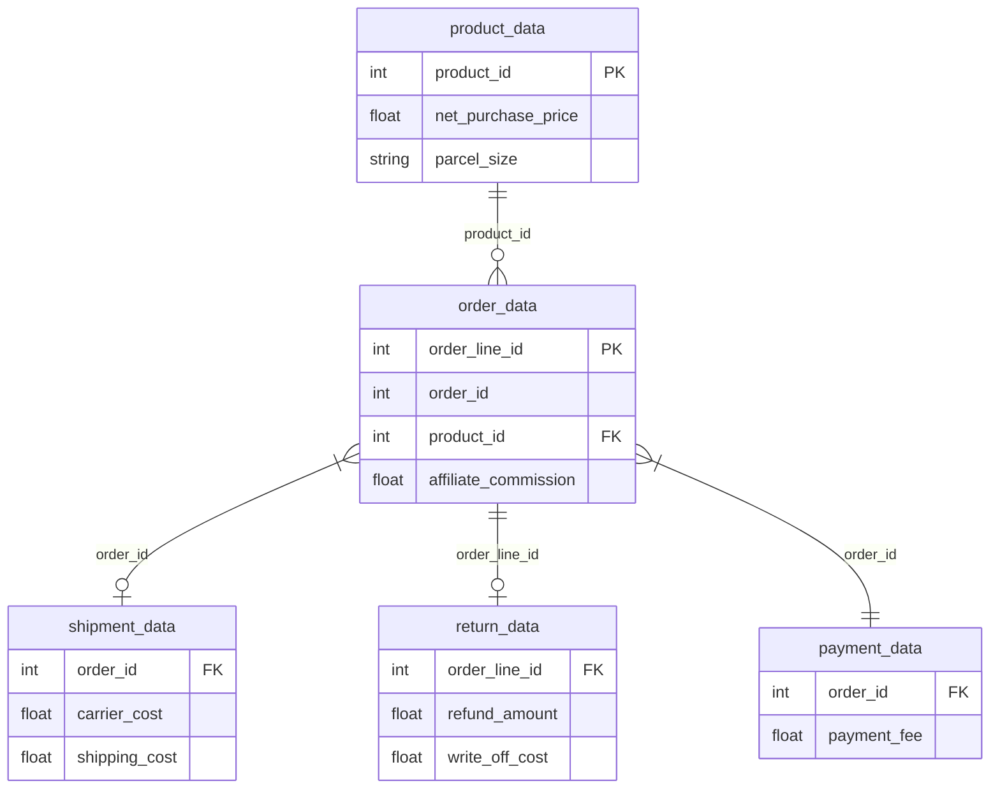

# Product Profitability

[](https://github.com/tlabedzki/Product-Profitability/actions/workflows/tests.yml)


Studium przypadku i aplikacja: ile naprawdę zarabia każdy produkt fikcyjnego sklepu internetowego po rabatach,
zwrotach, wysyłce, opłatach za płatność i prowizjach.

**Problem.** Właściciel sklepu widzi w cenniku marżę: cenę minus koszt zakupu. Nie widzi, ile z niej zostaje, bo
kurier, zwroty, operator płatności i partnerzy wystawiają faktury na przesyłkę albo zamówienie, a nie na produkt.
Bestseller może więc przynosić stratę miesiącami i nikt tego nie zauważy.

**Podejście.** Projekt rozkłada każdy koszt z faktur na produkty, liczy marżę krok po kroku od cennika do marży na
czysto, czyli tego, co zostaje po wszystkich kosztach sprzedaży, i przy każdym stratnym bestsellerze podaje powód
oraz jeden ruch: zmianę ceny, koniec darmowej dostawy albo wycofanie.

<!-- generated:result -->
**Wynik.** Z 16,5 mln zł marży z cennika zostaje 10,1 mln zł, czyli 61%. Najwięcej zabierają zwroty (2,49 mln zł) i
rabaty (2,47 mln zł). 44 z 500 bestsellerów traci pieniądze, razem 73,0 tys. zł.
<!-- /generated:result -->

<!-- generated:hero -->

<!-- /generated:hero -->

**Stack:** Python · SQL · DuckDB · pandas · Plotly · Dash · pytest

<!-- generated:summary -->
- **Trafione:** każdy z 8 kosztów rozkłada się na produkty co do grosza (największa różnica 0,00 zł). Na minusie jest
  2 167 z 22 714 sprzedanych produktów, ale tylko 44 z nich to bestsellery, więc lista do decyzji jest krótka.
- **Chybione:** ruch „bez darmowej dostawy” nie pada ani razu (0 z 44). 38 z 44 stratnych bestsellerów to elektronika
  sprzedawana w kilku sztukach (mediana 5), więc jeden zwrot zmienia wynik.
<!-- /generated:summary -->

## 1. Sklep i pytanie właściciela

Lumo to fikcyjny polski sklep internetowy z danymi z [Data-Generatora](https://github.com/tlabedzki/Data-Generator):
dwa lata zamówień, zwrotów, przesyłek i płatności. Właściciel zna marżę z cennika i chce wiedzieć trzy rzeczy:

- ile tej marży zostaje po wszystkich kosztach sprzedaży i który koszt zabiera najwięcej (rozdział 3);
- które kategorie zarabiają najmniej (rozdział 4);
- które z najlepiej sprzedających się produktów tracą pieniądze, dlaczego i co z nimi zrobić (rozdziały 5 i 6).

## 2. Skąd wiadomo, co jest prawdą

Dane są fikcyjne, ale koszty są naliczane jak w prawdziwym sklepie, tam gdzie wystawia je dostawca. Przewoźnik
liczy za przesyłkę, operator płatności za zamówienie, a sieć partnerska za linię zamówienia. Sieć partnerska to
strony, które polecają sklep i biorą procent od sprzedaży, czyli prowizję afiliacyjną. Zwrot kosztuje etykietę,
obsługę i czasem odpis, czyli towar, którego nie da się już sprzedać. Stawki tych kosztów leżą w ustawieniach
generatora, więc wiadomo, skąd wzięła się każda kwota.

Wynik da się sprawdzić na trzy sposoby:

- **Rozliczenie co do grosza.** Suma każdego kosztu w tabelach równa się sumie tego kosztu rozpisanego na produkty.
  `python main.py` kończy się błędem, gdy różnica przekroczy pół grosza.
- **Sklep policzony ręcznie.** Testy mają mały sklep z pięciu zamówień, w którym każdą marżę policzono na kartce.
  Kod musi dać te same kwoty.
- **Netto z VAT, nie z kolumn.** Przychód netto to cena brutto po rabacie podzielona przez 1,23 (VAT 23%). Test
  pilnuje, że model nie czyta kolumn netto z danych.

Zamówienia oznaczone w danych jako oszustwa są poza marżą produktów. Rozliczenie pokazuje ich koszty osobno.

## 3. Ile marży zostaje po kosztach sprzedaży?

**Pytanie.** Ile z marży z cennika zostaje po wszystkich kosztach sprzedaży i co zabiera najwięcej?

**Co robi analiza.** Zapytanie SQL w DuckDB (baza danych w pamięci, która czyta tabele wprost z plików) rozkłada koszty
zamówienia na jego linie: koszt przewoźnika według wielkości paczki każdego produktu, opłatę za płatność według
wartości linii. Potem kaskada odejmuje od marży z cennika (cena netto minus koszt zakupu) kolejno rabaty, zwroty,
wysyłkę, opłaty za płatność i prowizje. Zostaje marża na czysto.

**Jak to sprawdzamy.** Rozliczenie z rozdziału 2: suma kroków kaskady równa się sumie kosztów w tabelach.

**Wynik.**

<!-- generated:cascade -->


Rabaty i zwroty to razem 30% marży z cennika. Wysyłka netto, czyli koszt przewoźnika minus to, co zapłacili klienci, to
tylko 435,1 tys. zł, choć 78% wysłanych linii jechało z darmową dostawą.
<!-- /generated:cascade -->

**Co to znaczy dla właściciela.** Najwięcej pieniędzy ucieka przez rabaty i zwroty, kurier kosztuje dużo mniej.
Tam warto szukać oszczędności najpierw: w zasadach rabatów i w tym, co powoduje zwroty.

## 4. Które kategorie zarabiają najmniej?

**Pytanie.** Czy koszty sprzedaży rozkładają się równo, czy któraś kategoria traci dużo więcej?

**Co robi analiza.** Ta sama kaskada dla każdej kategorii osobno: jaki udział marży z cennika zostaje po kosztach
i który koszt zabiera najwięcej.

**Wynik.**

<!-- generated:categories -->


Rozpiętość między kategoriami jest duża: Elektronika zatrzymuje 47%, Zdrowie 84%.
<!-- /generated:categories -->

**Co to znaczy dla właściciela.** Kategoria z wysoką marżą w cenniku nie musi być najlepsza. Odzież ma dużą marżę,
ale zwroty zabierają z niej sporo, a elektronika zaczyna od cienkiej marży, którą rabaty łatwo zjadają.

## 5. Które bestsellery tracą pieniądze i co z nimi zrobić?

**Pytanie.** Które z najlepiej sprzedających się produktów przynoszą stratę i jaki jeden ruch ją zatrzyma?

**Co robi analiza.** Bestseller to jeden z 500 produktów z najwyższym przychodem netto. Przy każdym stratnym
bestsellerze kod wskazuje koszt, który zabrał najwięcej, i dobiera ruch według reguł:

- **Zmień cenę:** ogranicz rabat do poziomu, przy którym produkt wychodzi na zero, albo podnieś cenę, jeśli
  wystarczy podwyżka do 10%.
- **Bez darmowej dostawy:** gdy najwięcej zabiera wysyłka, a co najmniej połowa zamówień jechała za darmo.
- **Wycofaj:** gdy zwrotów jest co najmniej dwa razy więcej niż w kategorii albo do wyjścia na zero trzeba podwyżki
  powyżej 10%.

Liczbę bestsellerów i limit podwyżki zmienia się suwakami w aplikacji; lista przelicza się od razu.

**Wynik.**

<!-- generated:losses -->
44 z 500 bestsellerów traci pieniądze, razem −73,0 tys. zł. Ruchy: zmiana ceny 33, koniec darmowej dostawy 0, wycofanie
11. Dziesięć największych strat:

| # | Produkt | Kategoria | Sztuki | Marża na czysto | Główny koszt | Ruch |
|---:|---|---|---:|---:|---|---|
| 99 | Smartphone Xiaomi Redmi 12C (fioletowy) | Elektronika | 7 | −5 708 zł | rabaty | Zmień cenę |
| 374 | Smartphone Samsung Galaxy S24 (wielokolorowy) | Elektronika | 4 | −4 976 zł | rabaty | Zmień cenę |
| 81 | Laptop Lenovo IdeaPad Slim 5 (szary) | Elektronika | 5 | −4 950 zł | rabaty | Zmień cenę |
| 258 | Laptop Lenovo IdeaPad Slim 5 (granatowy) | Elektronika | 4 | −4 606 zł | rabaty | Zmień cenę |
| 166 | Smartphone Apple iPhone 15 Pro (beżowy) | Elektronika | 7 | −4 147 zł | cena poniżej kosztu | Wycofaj |
| 269 | Laptop Lenovo IdeaPad Slim 5 (niebieski) | Elektronika | 5 | −3 882 zł | rabaty | Wycofaj |
| 237 | Laptop Asus ZenBook 14 (zielony) | Elektronika | 4 | −3 633 zł | rabaty | Zmień cenę |
| 368 | Laptop Lenovo IdeaPad Slim 5 (biały) | Elektronika | 3 | −3 501 zł | zwroty | Wycofaj |
| 70 | Smartphone Xiaomi Redmi Note 12 (beżowy) | Elektronika | 6 | −3 209 zł | rabaty | Zmień cenę |
| 17 | Smartphone Sony Xperia 10 V (czarny) | Elektronika | 10 | −3 054 zł | cena poniżej kosztu | Zmień cenę |
<!-- /generated:losses -->

**Co to znaczy dla właściciela.** Lista do decyzji jest krótka i każda pozycja ma gotowy ruch. Przy większości
produktów wystarczy mniejszy rabat albo wyższa cena; wycofanie dotyczy mniejszej części listy.

## 6. Karta produktu: co stoi za stratą?

**Pytanie.** Skąd wzięła się strata konkretnego produktu?

**Co robi analiza.** Kliknięcie produktu w tabeli otwiera jego kartę: własną kaskadę marży i listę wszystkich
zamówień z marżą na czysto każdej linii, czyli z jej częścią kosztów dostawy i płatności.

**Wynik.**

<!-- generated:card -->


Największa strata wśród bestsellerów: Smartphone Xiaomi Redmi 12C (fioletowy), −5 708 zł. Rabaty (średnio 34%) zabrały
10 040 zł przy marży z cennika 4 862 zł. Ogranicz rabat do 14%, żeby wyjść na zero.
<!-- /generated:card -->

**Co to znaczy dla właściciela.** Zanim zmieni cenę albo wycofa produkt, widzi zamówienia, które złożyły się na
stratę, i może sprawdzić, czy to stały problem, czy jedno nietypowe zamówienie.

## 7. Co nie zadziałało i czego to uczy

- **Ruch „bez darmowej dostawy” nie pada ani razu.** Bestseller według przychodu to zwykle drogi produkt, a przy
  drogim produkcie paczka kosztuje ułamek ceny, więc wysyłka nigdy nie jest jego głównym kosztem. Lekcja: reguła
  działa w testach, ale te dane jej nie uruchamiają. Przy bestsellerach liczonych w sztukach, czyli tanich
  i gabarytowych, mogłaby się pojawić.
- **Bestsellery sprzedane w kilku sztukach.** Sklep ma bardzo szeroki katalog, więc nawet produkt z czołowej
  pięćsetki sprzedaje się w kilku sztukach i jeden odpisany telefon decyduje o wyniku. Lekcja: przed wycofaniem
  trzeba sprawdzić kartę produktu, a w prawdziwym sklepie liczyć dłuższy okres albo dodać próg minimalnej liczby
  sztuk.
- **Rabaty w elektronice to ustawienie generatora.** Wniosek o rabatach powyżej marży jest prawdziwy dla tych danych,
  ale wynika z tego, jak generator rozdaje rabaty. W prawdziwym sklepie ta sama kaskada odpowie na to samo pytanie
  na jego danych.
- **Podział kosztów zamówienia to założenie.** Inny klucz podziału (na przykład po równo na linie) przesunie koszty
  między produktami, ale nie zmieni sumy; rozliczenie co do grosza pilnuje tylko sumy.

Te pomyłki są opisane wprost, bo pokazują granice narzędzia. Rozliczenie co do grosza mówi, że żaden koszt nie
zginął, a te punkty mówią, gdzie wynik zależy od danych i przyjętych reguł.

## 8. Wnioski i ograniczenia

**Rekomendacje.**

1. Zacząć od rabatów: ograniczyć je przy produktach z cienką marżą do poziomu, przy którym wychodzą na zero.
2. Przy produktach ze zwrotami ponad średnią kategorii poprawić opis i rozmiarówkę albo zmienić dostawcę.
3. Przed wycofaniem bestsellera otworzyć jego kartę i sprawdzić, czy strata nie wynika z jednego zamówienia.

**Ograniczenia.** Dane są syntetyczne, z jednego przebiegu generatora (ziarno 42, czyli stały punkt startu
losowania: każdy przebieg daje te same dane). Stawki kosztów są fikcyjne;
w prawdziwym sklepie przyszłyby z umów z przewoźnikiem, operatorem płatności i siecią partnerską. Marketing poza
prowizją (kampanie) nie wchodzi do marży produktu. Reguły ruchów (500 bestsellerów, podwyżka do 10%, połowa zamówień
z darmową dostawą, zwroty dwa razy powyżej kategorii) to decyzje projektu, które aplikacja pozwala zmienić.

## Szybki start

Potrzebny jest Git i Python 3.11. Sklonuj repozytorium:

```bash
git clone https://github.com/tlabedzki/Product-Profitability.git
cd Product-Profitability
```

<details><summary>Utwórz i włącz środowisko wirtualne z Pythonem 3.11 (Windows, macOS i Linux)</summary>

Podanie wersji wybiera Pythona 3.11, nawet jeśli domyślny jest inny.

| Krok | Windows (PowerShell) | macOS i Linux |
|---|---|---|
| Utworzenie | `py -3.11 -m venv .venv` | `python3.11 -m venv .venv` |
| Włączenie | `.venv\Scripts\Activate.ps1` | `source .venv/bin/activate` |
| Sprawdzenie | `python --version` pokazuje `Python 3.11.x` | `python --version` pokazuje `Python 3.11.x` |

Jeśli PowerShell mówi, że uruchamianie skryptów jest wyłączone, uruchom raz
`Set-ExecutionPolicy -Scope CurrentUser RemoteSigned` i włącz środowisko jeszcze raz.

</details>

Potem zainstaluj pakiety, pobierz dane i policz marże:

```bash
pip install -r requirements.txt
python scripts/get_data.py
python main.py
```

`get_data.py` klonuje Data-Generator v1.7.1 i generuje dane sklepu w kilkanaście sekund. `main.py` wypisuje kaskadę
sklepu i stratne bestsellery oraz zapisuje `output/product_margins.csv` i `output/loss_making_bestsellers.csv`.

### Aplikacja

`python -m ui.app` uruchamia aplikację pod adresem http://127.0.0.1:8050 (tylko na tym komputerze). Kartę produktu
otwiera też adres `/?product=<id>`. Zatrzymanie: Ctrl+C.

## Dane

Wszystko jest syntetyczne: Data-Generator v1.7.1 (wydanie z 2026-11-24, licencja MIT) z ziarnem 42 tworzy sklep
Lumo i jego koszty; `scripts/get_data.py` odtwarza dane z tego wydania. Nazwy marek w nazwach produktów służą tylko
realizmowi danych; sklep, zamówienia i koszty są fikcyjne. Projekt czyta pięć tabel:



Pełny opis kolumn wejścia i wyniku: [docs/columns.md](docs/columns.md).

## Struktura projektu

<details><summary>Pokaż drzewo</summary>

```
main.py                         wiersz poleceń: kaskada, stratne bestsellery, pliki CSV
scripts/get_data.py             dane z Data-Generatora (tag, ziarno 42) do data/raw/
scripts/make_charts.py          wykresy, zrzuty aplikacji i bloki liczb w README
scripts/browser.py              headless Chrome przez DevTools (wykresy i zrzuty)
src/product_profitability/
  data.py                       wczytanie tabel i kontrakt kolumn kosztów
  mock_costs.py                 zastępcze koszty dla wydań Data-Generatora sprzed 1.7.0
  sql/line_costs.sql            koszty zamówienia rozpisane na linie (DuckDB)
  margin.py                     kaskada marży i rozliczenie co do grosza
  diagnose.py                   stratne bestsellery: powód i ruch
  report.py, figures.py         dane, tytuły i wykresy wspólne dla aplikacji i README
  i18n.py, theme.py             słowa po angielsku i po polsku, kolory i krój pisma
ui/                             aplikacja Dash + Mantine
tests/                          pytest
```

</details>

## Testy

```bash
pip install -r requirements-dev.txt
python -m pytest
```

71 testów sprawdza ręcznie policzony sklep, rozliczenie kosztów, reguły ruchów, wczytywanie danych, wykresy
i aplikację bez przeglądarki; trwają kilka sekund i nie potrzebują pobranych danych.

## Licencja

MIT, zobacz [LICENSE](LICENSE). [Changelog](CHANGELOG.md).

Ostatnia aktualizacja README: 2026-11-24
