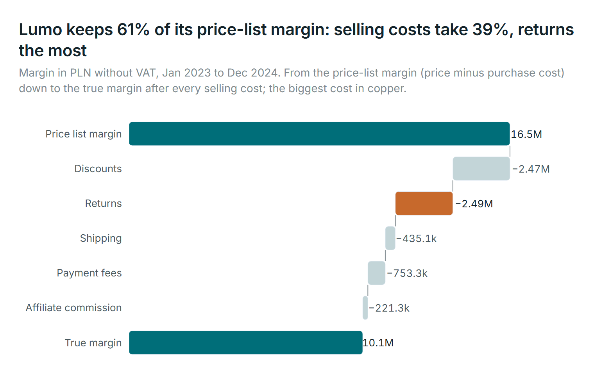
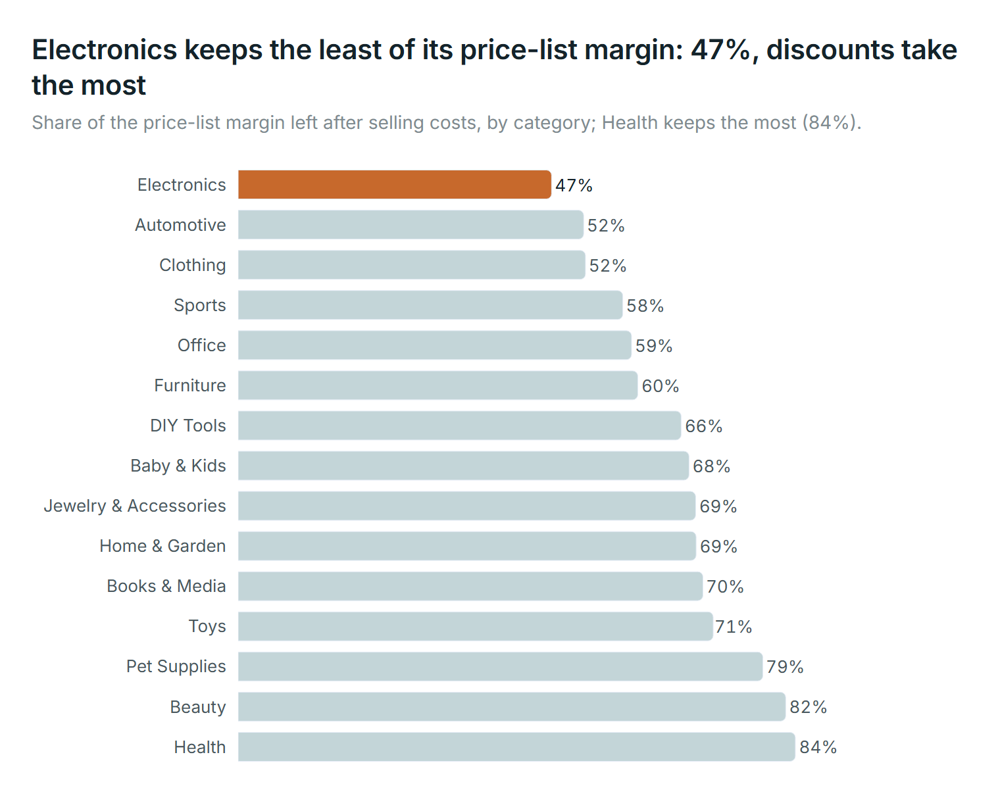
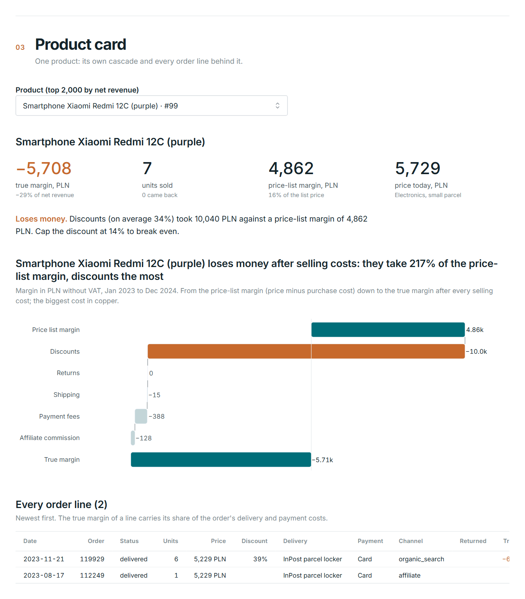
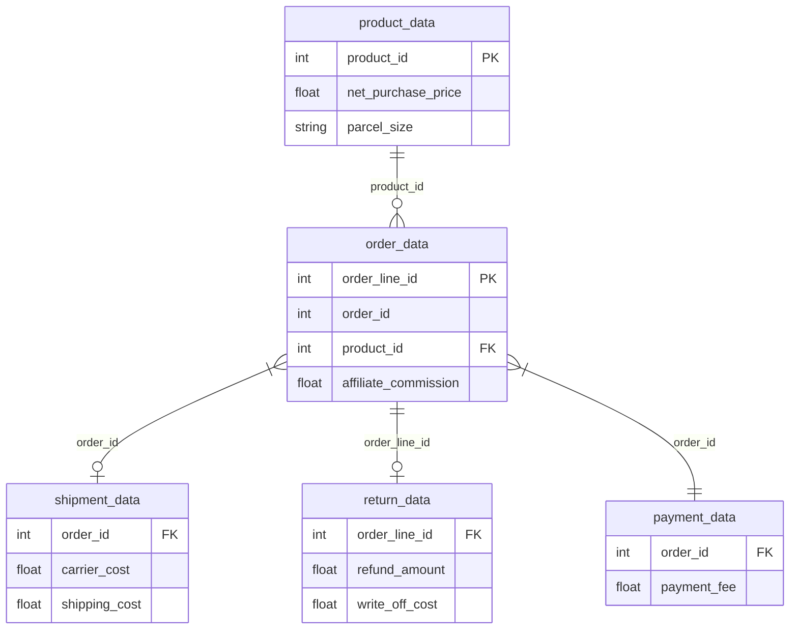

# Product Profitability

[](https://github.com/tlabedzki/Product-Profitability/actions/workflows/tests.yml)


[](https://github.com/tlabedzki/Product-Profitability/releases)

A case study and an app: what each product of a fictional online shop really earns after discounts, returns,
shipping, payment fees and commissions.

**Problem.** A shop owner sees the margin in the price list: the price minus the purchase cost. They cannot see how
much of it is left, because carriers, returns, payment operators and partners invoice per parcel or per order, not
per product. A bestseller can lose money for months and nobody notices.

**Approach.** The project spreads every invoiced cost over the products, follows each product's margin step by step
from the price list to the true margin, which is what is left after every selling cost, and gives every
loss-making bestseller a reason and one move: change the price, end free delivery or delist it.

<!-- generated:result -->
**Result.** Of 16.5M PLN of price-list margin, 10.1M PLN is left, or 61%. Returns (2.49M PLN) and discounts (2.47M PLN)
take the most. 44 of the top 500 bestsellers lose money, 73.0k PLN together.
<!-- /generated:result -->

<!-- generated:hero -->
<picture>
  <source media="(prefers-color-scheme: dark)" srcset="docs/img/app-demo-dark.svg">
  
</picture>
<!-- /generated:hero -->

**Stack:** Python · SQL · DuckDB · pandas · Plotly · Dash · pytest

<!-- generated:summary -->
- **What worked:** each of the 8 costs is spread over products to the grosz (largest difference 0.00 PLN). 2,167 of
  22,714 products sold lose money, but only 44 of them are bestsellers, so the list to act on is short.
- **What missed:** the move "end free delivery" never fires (0 of 44). 38 of the 44 loss-making bestsellers are
  electronics sold in a few units (median 5), so one return changes the result.
<!-- /generated:summary -->

## 1. The shop and the owner's question

Lumo is a fictional Polish online shop with data from [Data-Generator](https://github.com/tlabedzki/Data-Generator):
two years of orders, returns, parcels and payments. The owner knows the price-list margin and wants to know three
things:

- how much of that margin is left after every selling cost, and which cost takes the most (chapter 3);
- which categories earn the least (chapter 4);
- which of the best-selling products lose money, why, and what to do about them (chapters 5 and 6).

## 2. How we know the truth

The data is fictional, but the costs arrive the way they do in a real shop, where the supplier invoices them. The
carrier charges per parcel, the payment operator per order and the affiliate network per order line. An affiliate
network is a group of sites that recommend the shop and take a share of the sale, the affiliate commission. A return
costs a label, handling and sometimes a write-off, that is goods that can no longer be sold. The rates of these costs
sit in the generator's settings, so every amount can be traced to where it came from.

The result can be checked in three ways:

- **Reconciled to the grosz.** The total of every cost in the tables equals the total of that cost spread over
  products (a grosz is one hundredth of a zloty). `python main.py` stops with an error when they differ by more
  than half a grosz.
- **A shop worked out by hand.** The tests hold a small shop of five orders whose margins were worked out on paper.
  The code has to return the same amounts.
- **Net from VAT, not from columns.** Net revenue is the gross price after discount divided by 1.23 (23% VAT). A test
  makes sure the model never reads the net columns of the data.

Orders labelled as fraud in the data are left out of the product margins. The reconciliation shows their costs
separately.

## 3. How much margin is left after selling costs?

**Question.** How much of the price-list margin is left after every selling cost, and what takes the most?

**What we did.** A SQL query in DuckDB (an in-memory database that reads tables straight from files) spreads the
costs of an order over its lines: the carrier cost by the parcel size of each product, the payment fee by the line
value. The cascade then takes away from the price-list margin (net price minus purchase cost) the discounts, returns,
shipping, payment fees and commission, one by one. What is left is the true margin.

**How we check it.** The reconciliation from chapter 2: the steps of the cascade add up to the costs in the tables.

**Result.**

<!-- generated:cascade -->


Discounts and returns together take 30% of the price-list margin. Net shipping, the carrier cost minus what customers
paid, is only 435.1k PLN, although 78% of shipped lines went with free delivery.
<!-- /generated:cascade -->

**What it means for the owner.** Most of the money leaks through discounts and returns; the carrier costs far less.
That is where to look for savings first: in the discount rules and in what causes returns.

## 4. Which categories earn the least?

**Question.** Do selling costs fall evenly, or does one category lose much more?

**What we did.** The same cascade for each category: what share of the price-list margin is left after the costs,
and which cost takes the most.

**Result.**

<!-- generated:categories -->


The spread between categories is wide: Electronics keeps 47%, Health 84%.
<!-- /generated:categories -->

**What it means for the owner.** A category with a high margin in the price list is not necessarily the best one.
Clothing has a wide margin, but returns take a lot of it, while electronics starts from a thin margin that discounts
eat easily.

## 5. Which bestsellers lose money, and what to do about them?

**Question.** Which of the best-selling products lose money, and which single move would stop the loss?

**What we did.** A bestseller is one of the 500 products with the highest net revenue. For each loss-making
bestseller the code names the cost that took the most and picks a move by these rules:

- **Change the price:** cap the discount where the product breaks even, or raise the price if a rise of up to 10% is
  enough.
- **End free delivery:** when shipping takes the most and at least half of the orders shipped free.
- **Delist:** when returns are at least twice the category's rate, or breaking even needs a price rise above 10%.

Sliders in the app change the number of bestsellers and the price-rise limit; the list updates at once.

**Result.**

<!-- generated:losses -->
44 of the top 500 bestsellers lose money, −73.0k PLN together. Moves: change the price 33, end free delivery 0, delist
11. The ten biggest losses:

| # | Product | Category | Units | True margin | Main cost | Move |
|---:|---|---|---:|---:|---|---|
| 99 | Smartphone Xiaomi Redmi 12C (purple) | Electronics | 7 | −5,708 PLN | discounts | Change the price |
| 374 | Smartphone Samsung Galaxy S24 (multicolor) | Electronics | 4 | −4,976 PLN | discounts | Change the price |
| 81 | Laptop Lenovo IdeaPad Slim 5 (gray) | Electronics | 5 | −4,950 PLN | discounts | Change the price |
| 258 | Laptop Lenovo IdeaPad Slim 5 (navy) | Electronics | 4 | −4,606 PLN | discounts | Change the price |
| 166 | Smartphone Apple iPhone 15 Pro (beige) | Electronics | 7 | −4,147 PLN | price below cost | Delist |
| 269 | Laptop Lenovo IdeaPad Slim 5 (blue) | Electronics | 5 | −3,882 PLN | discounts | Delist |
| 237 | Laptop Asus ZenBook 14 (green) | Electronics | 4 | −3,633 PLN | discounts | Change the price |
| 368 | Laptop Lenovo IdeaPad Slim 5 (white) | Electronics | 3 | −3,501 PLN | returns | Delist |
| 70 | Smartphone Xiaomi Redmi Note 12 (beige) | Electronics | 6 | −3,209 PLN | discounts | Change the price |
| 17 | Smartphone Sony Xperia 10 V (black) | Electronics | 10 | −3,054 PLN | price below cost | Change the price |
<!-- /generated:losses -->

**What it means for the owner.** The list to act on is short and every line has a move ready. For most products a
smaller discount or a higher price is enough; delisting is for a smaller part of the list.

## 6. Product card: what is behind a loss?

**Question.** Where did the loss of one particular product come from?

**What we did.** A click on a product in the table opens its card: its own margin cascade and every order line with
its true margin, that is with its share of the delivery and payment costs.

**Result.**

<!-- generated:card -->


The biggest loss among bestsellers: Smartphone Xiaomi Redmi 12C (purple), −5,708 PLN. Discounts (on average 34%) took
10,040 PLN against a price-list margin of 4,862 PLN. Cap the discount at 14% to break even.
<!-- /generated:card -->

**What it means for the owner.** Before changing the price or delisting a product, the owner sees the orders behind
the loss and can tell a lasting problem from one unusual order.

## 7. What did not work, and what it teaches

- **The move "end free delivery" never fires.** A bestseller by revenue is usually an expensive product, and for an
  expensive product the parcel costs a fraction of the price, so shipping is never its main cost. Lesson: the rule
  works in the tests, but this data does not trigger it. Bestsellers counted in units, which are cheap and bulky,
  could trigger it.
- **Bestsellers sold in a few units.** The shop has a very wide catalogue, so even a top-500 product sells only a few
  units, and one written-off phone decides the result. Lesson: check the product card before delisting; in a real
  shop use a longer period or a minimum number of units.
- **The discounts in electronics are a generator setting.** The finding that discounts exceed the margin holds for
  this data, but it comes from how the generator hands out discounts. In a real shop the same cascade answers the
  same question on that shop's data.
- **Splitting order costs is an assumption.** Another split (for example equally over the lines) would move costs
  between products without changing the total; the reconciliation only guards the total.

These misses are stated openly because they show the limits of the tool. The reconciliation says that no cost went
missing; these points say where the result depends on the data and on the rules chosen.

## 8. Takeaways and limitations

**Recommendations.**

1. Start with discounts: cap them on thin-margin products where the product still breaks even.
2. For products returned more often than their category, improve the description and the size guide, or change the
   supplier.
3. Before delisting a bestseller, open its card and check that the loss does not come from a single order.

**Limitations.** The data is synthetic, from one run of the generator (seed 42, a fixed starting point for the
random draws, so every run gives the same data). The cost rates are fictional; in a real shop they would come from
the contracts with the carrier, the payment operator and the affiliate network. Marketing beyond the commission
(campaigns) is not part of the product margin. The rules of the moves (500 bestsellers, a price rise of up to 10%,
half the orders with free delivery, returns twice the category's rate) are choices of the project, and the app lets
you change them.

## Quickstart

You need Git and Python 3.11. Clone the repository:

```bash
git clone https://github.com/tlabedzki/Product-Profitability.git
cd Product-Profitability
```

<details><summary>Create and activate a virtual environment with Python 3.11 (Windows, macOS and Linux)</summary>

Naming the version picks Python 3.11 even if another one is the default.

| Step | Windows (PowerShell) | macOS and Linux |
|---|---|---|
| Create | `py -3.11 -m venv .venv` | `python3.11 -m venv .venv` |
| Activate | `.venv\Scripts\Activate.ps1` | `source .venv/bin/activate` |
| Check | `python --version` prints `Python 3.11.x` | `python --version` prints `Python 3.11.x` |

If PowerShell says that running scripts is disabled, run `Set-ExecutionPolicy -Scope CurrentUser RemoteSigned` once
and activate again.

</details>

Then install the packages, get the data and work out the margins:

```bash
pip install -r requirements.txt
python scripts/get_data.py
python main.py
```

`get_data.py` clones Data-Generator v1.7.1 and generates the shop data in about 15 seconds. `main.py` prints the
shop's cascade and the loss-making bestsellers and saves `output/product_margins.csv` and
`output/loss_making_bestsellers.csv`.

### App

`python -m ui.app` starts the app at http://127.0.0.1:8050 (on this computer only). The address also sets the sliders
and the product card, so a view can be kept as a link: `/?bestsellers=200&rise=15&product=<id>`. Stop it with Ctrl+C.

## Data

Everything is synthetic: Data-Generator v1.7.1 (released 2026-11-24, MIT license) with seed 42 creates the shop Lumo
and its costs; `scripts/get_data.py` rebuilds the data from that release. Brand names in product names are there only
to make the data realistic; the shop, its orders and its costs are fictional. The project reads five tables:



Every input and output column: [docs/columns.md](docs/columns.md).

## Project structure

<details><summary>Show the tree</summary>

```
main.py                         command line: cascade, loss-making bestsellers, CSV files
scripts/get_data.py             data from Data-Generator (tag, seed 42) to data/raw/
scripts/make_charts.py          charts, the product card screenshot and the numbers in README
scripts/make_demo_svg.py        the animation at the top of README (app screenshots, light and dark frame)
scripts/browser.py              headless Chrome through DevTools (charts and screenshots)
src/product_profitability/
  data.py                       loading the tables and the contract of the cost columns
  mock_costs.py                 stand-in costs for Data-Generator releases before 1.7.0
  sql/line_costs.sql            order costs spread over the lines (DuckDB)
  margin.py                     margin cascade and the reconciliation to the grosz
  diagnose.py                   loss-making bestsellers: reason and move
  report.py, figures.py         data, titles and charts shared by the app and README
  i18n.py, theme.py             English and Polish wording, colours and typeface
ui/                             Dash + Mantine app
tests/                          pytest
```

</details>

## Tests

```bash
pip install -r requirements-dev.txt
python -m pytest
```

74 tests check the shop worked out by hand, the cost reconciliation, the rules of the moves, data loading, the charts
and the app without a browser; they take a few seconds and need no downloaded data.

## License

MIT, see [LICENSE](LICENSE). [Changelog](CHANGELOG.md).

README last updated: 2026-11-24
