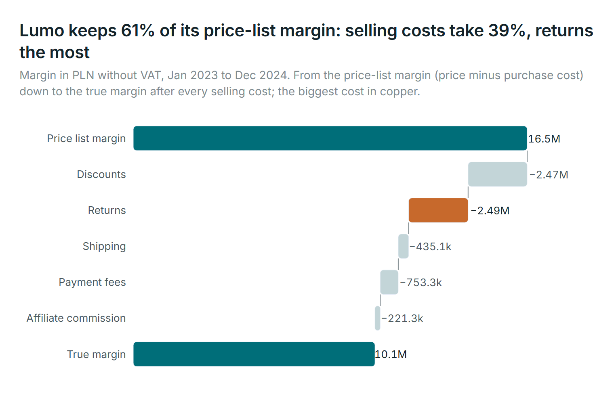
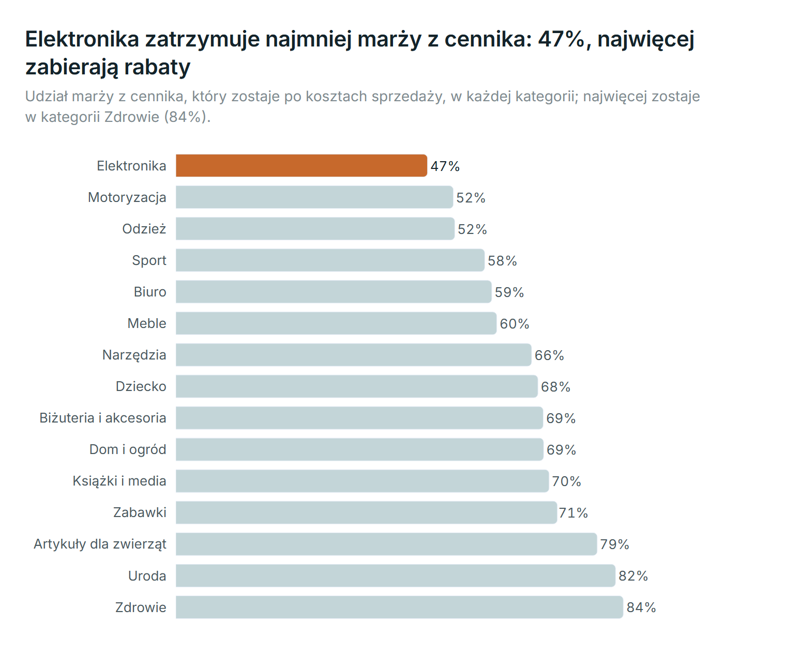
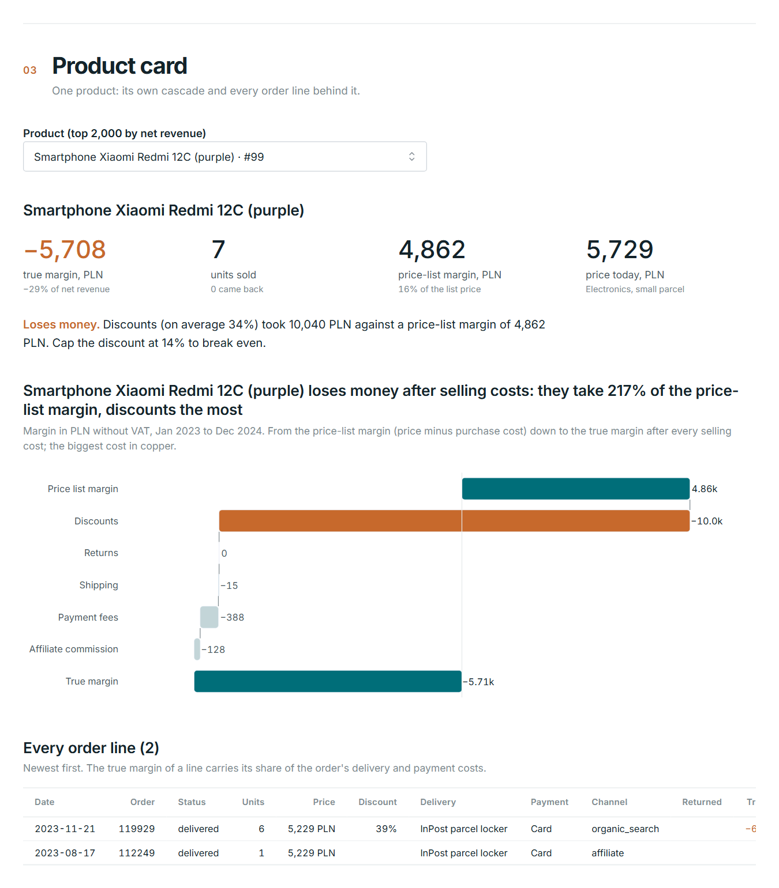
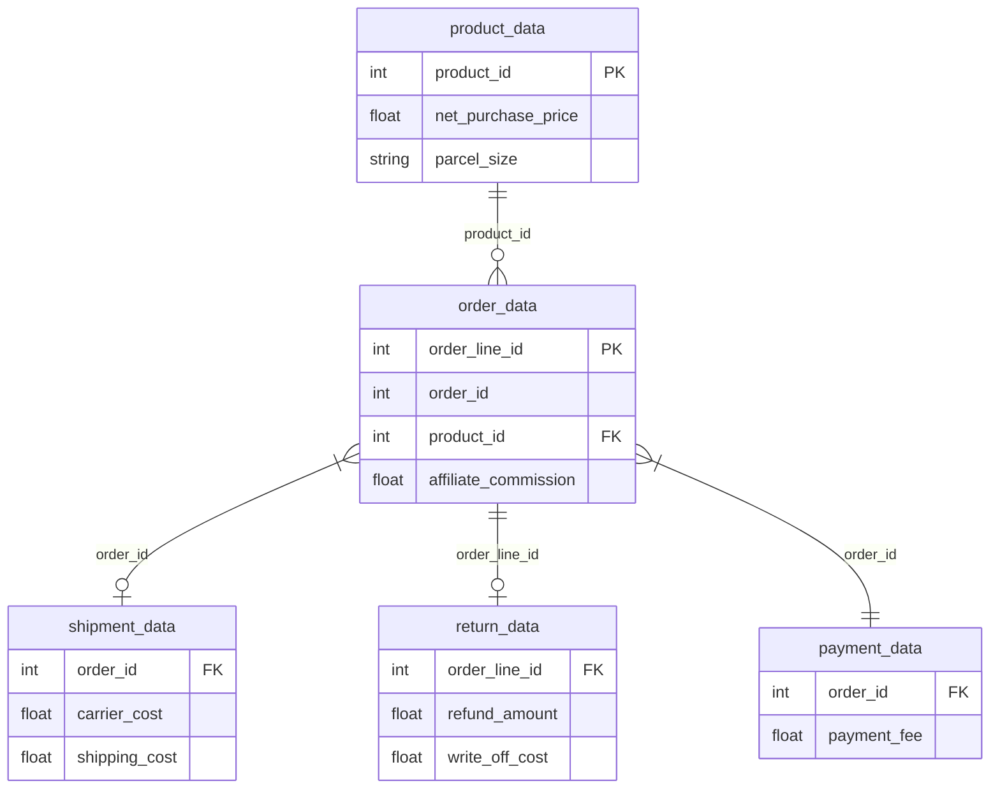

# Product Profitability

[English](README.md) | **Polski**

[](https://github.com/tlabedzki/Product-Profitability/actions/workflows/tests.yml)


[](https://github.com/tlabedzki/Product-Profitability/releases)

Studium przypadku (case study) i aplikacja: ile naprawdę zarabia każdy produkt fikcyjnego sklepu internetowego po
rabatach, zwrotach, wysyłce, opłatach za płatności i prowizjach.

**Problem.** Właściciel sklepu widzi marżę z cennika (price-list margin): cenę minus koszt zakupu. Nie widzi, ile
z niej zostaje, bo koszty przewoźników, zwrotów, operatorów płatności i partnerów przychodzą za paczkę albo za
zamówienie, a nie za produkt. Bestseller może miesiącami tracić pieniądze i nikt tego nie zauważa.

**Podejście.** Projekt rozkłada każdy zafakturowany koszt na produkty. Potem krok po kroku śledzi marżę każdego
produktu: od marży z cennika do marży na czysto (true margin), czyli tego, co zostaje po wszystkich kosztach
sprzedaży. Dla każdego stratnego bestsellera (produktu z czołówki sprzedaży, który przynosi stratę) podaje przyczynę
i jeden ruch: zmianę ceny, koniec darmowej dostawy albo wycofanie z oferty.

<!-- generated:result -->
**Wynik.** Z 16,5 mln zł marży z cennika zostaje 10,1 mln zł, czyli 61%. Najwięcej zabierają zwroty (2,49 mln zł) i
rabaty (2,47 mln zł). 44 z 500 bestsellerów traci pieniądze, razem 73,0 tys. zł.
<!-- /generated:result -->

<!-- generated:hero -->
<picture>
  <source media="(prefers-color-scheme: dark)" srcset="docs/img/app-demo-dark.svg">
  
</picture>
<!-- /generated:hero -->

**Stack:** Python · SQL · DuckDB · pandas · Plotly · Dash · pytest

<!-- generated:summary -->
- **Trafione:** każdy z 8 kosztów rozkłada się na produkty co do grosza (największa różnica 0,00 zł). Na minusie jest
  2 167 z 22 714 sprzedanych produktów, ale tylko 44 z nich to bestsellery, więc lista do decyzji jest krótka.
- **Chybione:** ruch „bez darmowej dostawy” nie pada ani razu (0 z 44). 38 z 44 stratnych bestsellerów to elektronika
  sprzedawana w kilku sztukach (mediana 5), więc jeden zwrot zmienia wynik.
<!-- /generated:summary -->

## 1. Sklep i pytania właściciela

Lumo to fikcyjny polski sklep internetowy z danymi z [Data-Generatora](https://github.com/tlabedzki/Data-Generator):
dwa lata zamówień, zwrotów, paczek i płatności. Właściciel zna marżę z cennika i chce wiedzieć trzy rzeczy:

- ile z tej marży zostaje po wszystkich kosztach sprzedaży i który koszt zabiera najwięcej (rozdział 3);
- które kategorie zarabiają najmniej (rozdział 4);
- które z najlepiej sprzedających się produktów tracą pieniądze, dlaczego tak jest i co z nimi zrobić (rozdziały 5
  i 6).

## 2. Skąd wiadomo, co jest prawdą

Dane są fikcyjne, ale koszty przychodzą tak jak w prawdziwym sklepie, czyli na fakturach od dostawców usług.
Przewoźnik liczy za paczkę, operator płatności za zamówienie, a sieć afiliacyjna za linię zamówienia (jedną pozycję
w koszyku). Sieć afiliacyjna (affiliate network) to grupa stron, które polecają sklep i biorą za to część sprzedaży,
czyli prowizję afiliacyjną (affiliate commission). Zwrot kosztuje etykietę, obsługę, a czasem odpis (write-off),
czyli towar, którego nie da się już sprzedać. Stawki tych kosztów są w ustawieniach generatora, więc każdą kwotę da
się prześledzić aż do jej źródła.

Wynik można sprawdzić na trzy sposoby:

- **Uzgodnienie co do grosza.** Uzgodnienie (reconciliation) to porównanie dwóch sum, które muszą się zgadzać: suma
  każdego kosztu w tabelach równa się sumie tego kosztu rozłożonego na produkty. `python main.py` kończy się błędem,
  gdy różnica przekracza pół grosza.
- **Sklep policzony ręcznie.** W testach jest mały sklep z pięcioma zamówieniami, którego marże policzono na kartce.
  Kod musi zwrócić te same kwoty.
- **Netto liczone z VAT, nie brane z kolumn.** Przychód netto (bez VAT) to cena brutto po rabacie podzielona przez
  1,23 (VAT 23%). Test pilnuje, żeby model nigdy nie czytał kolumn netto z danych.

Zamówienia oznaczone w danych jako oszustwa (fraud) nie wchodzą do marż produktów. Uzgodnienie pokazuje ich koszty
osobno.

## 3. Ile marży zostaje po kosztach sprzedaży?

**Pytanie.** Ile marży z cennika zostaje po wszystkich kosztach sprzedaży i co zabiera najwięcej?

**Co robi analiza.** Zapytanie SQL w DuckDB (baza danych działająca w pamięci, która czyta tabele prosto z plików)
rozkłada koszty zamówienia na jego linie: koszt przewoźnika według wielkości paczki każdego produktu, a opłatę za
płatność według wartości linii. Następnie kaskada marży (margin cascade), czyli rachunek schodkowy, odejmuje po kolei
od marży z cennika (cena netto minus koszt zakupu) rabaty, zwroty, wysyłkę, opłaty za płatności i prowizję. To, co
zostaje, jest marżą na czysto.

**Jak to sprawdzamy.** Uzgodnieniem z rozdziału 2: kroki kaskady sumują się do kosztów w tabelach.

**Wynik.**

<!-- generated:cascade -->


Rabaty i zwroty to razem 30% marży z cennika. Wysyłka netto, czyli koszt przewoźnika minus to, co zapłacili klienci, to
tylko 435,1 tys. zł, choć 78% wysłanych linii jechało z darmową dostawą.
<!-- /generated:cascade -->

**Co to znaczy dla właściciela.** Najwięcej pieniędzy ucieka przez rabaty i zwroty, a przewoźnik kosztuje dużo
mniej. Tam trzeba najpierw szukać oszczędności: w zasadach rabatów i w przyczynach zwrotów.

## 4. Które kategorie zarabiają najmniej?

**Pytanie.** Czy koszty sprzedaży rozkładają się równo, czy któraś kategoria traci dużo więcej?

**Co robi analiza.** Liczy tę samą kaskadę dla każdej kategorii: jaka część marży z cennika zostaje po kosztach
i który koszt zabiera najwięcej.

**Wynik.**

<!-- generated:categories -->


Rozpiętość między kategoriami jest duża: Elektronika zatrzymuje 47%, Zdrowie 84%.
<!-- /generated:categories -->

**Co to znaczy dla właściciela.** Kategoria z wysoką marżą w cenniku nie musi być najlepsza. Odzież ma szeroką
marżę, ale dużą jej część zabierają zwroty, a elektronika startuje z wąskiej marży, którą rabaty łatwo zjadają.

## 5. Które bestsellery tracą pieniądze i co z nimi zrobić?

**Pytanie.** Które z najlepiej sprzedających się produktów tracą pieniądze i jaki jeden ruch zatrzymałby stratę?

**Co robi analiza.** Bestseller to jeden z 500 produktów o najwyższym przychodzie netto. Dla każdego stratnego
bestsellera kod wskazuje koszt, który zabrał najwięcej. Potem wybiera ruch według tych zasad:

- **Zmień cenę:** ogranicz rabat do poziomu, przy którym produkt wychodzi na zero (break even, czyli przychód pokrywa
  wszystkie koszty), albo podnieś cenę, jeśli wystarczy podwyżka do 10%.
- **Bez darmowej dostawy:** gdy najwięcej zabiera wysyłka, a co najmniej połowa zamówień miała darmową dostawę.
- **Wycofaj:** gdy zwrotów jest co najmniej dwa razy więcej niż średnio w kategorii albo wyjście na zero wymaga
  podwyżki ceny powyżej 10%.

Suwaki w aplikacji zmieniają liczbę bestsellerów i limit podwyżki ceny, a lista od razu się odświeża.

**Wynik.**

<!-- generated:losses -->
44 z 500 bestsellerów traci pieniądze, razem −73,0 tys. zł. Ruchy: zmiana ceny 33, koniec darmowej dostawy 0, wycofanie
11. Dziesięć największych strat:

| # | Produkt | Kategoria | Sztuki | Marża na czysto | Główny koszt | Ruch |
|---:|---|---|---:|---:|---|---|
| 99 | Smartphone Xiaomi Redmi 12C (fioletowy) | Elektronika | 7 | −5 708 zł | rabaty | Zmień cenę |
| 374 | Smartphone Samsung Galaxy S24 (wielokolorowy) | Elektronika | 4 | −4 976 zł | rabaty | Zmień cenę |
| 81 | Laptop Lenovo IdeaPad Slim 5 (szary) | Elektronika | 5 | −4 950 zł | rabaty | Zmień cenę |
| 258 | Laptop Lenovo IdeaPad Slim 5 (granatowy) | Elektronika | 4 | −4 606 zł | rabaty | Zmień cenę |
| 166 | Smartphone Apple iPhone 15 Pro (beżowy) | Elektronika | 7 | −4 147 zł | cena poniżej kosztu | Wycofaj |
| 269 | Laptop Lenovo IdeaPad Slim 5 (niebieski) | Elektronika | 5 | −3 882 zł | rabaty | Wycofaj |
| 237 | Laptop Asus ZenBook 14 (zielony) | Elektronika | 4 | −3 633 zł | rabaty | Zmień cenę |
| 368 | Laptop Lenovo IdeaPad Slim 5 (biały) | Elektronika | 3 | −3 501 zł | zwroty | Wycofaj |
| 70 | Smartphone Xiaomi Redmi Note 12 (beżowy) | Elektronika | 6 | −3 209 zł | rabaty | Zmień cenę |
| 17 | Smartphone Sony Xperia 10 V (czarny) | Elektronika | 10 | −3 054 zł | cena poniżej kosztu | Zmień cenę |
<!-- /generated:losses -->

**Co to znaczy dla właściciela.** Lista do działania jest krótka, a każda pozycja ma gotowy ruch. Przy większości
produktów wystarczy mniejszy rabat albo wyższa cena; wycofanie dotyczy mniejszej części listy.

## 6. Karta produktu: co stoi za stratą?

**Pytanie.** Skąd wzięła się strata jednego konkretnego produktu?

**Co robi analiza.** Kliknięcie produktu w tabeli otwiera jego kartę: własną kaskadę marży produktu i każdą linię
zamówienia z jej marżą na czysto, czyli z jej udziałem w kosztach dostawy i płatności.

**Wynik.**

<!-- generated:card -->


Największa strata wśród bestsellerów: Smartphone Xiaomi Redmi 12C (fioletowy), −5 708 zł. Rabaty (średnio 34%) zabrały
10 040 zł przy marży z cennika 4 862 zł. Ogranicz rabat do 14%, żeby wyjść na zero.
<!-- /generated:card -->

**Co to znaczy dla właściciela.** Zanim zmieni cenę albo wycofa produkt, właściciel widzi zamówienia, które stoją za
stratą. Może więc odróżnić trwały problem od jednego nietypowego zamówienia.

## 7. Co nie zadziałało i czego to uczy

- **Ruch „bez darmowej dostawy” nie pada ani razu.** Bestseller liczony według przychodu to zwykle drogi produkt,
  a przy drogim produkcie paczka kosztuje ułamek ceny, więc wysyłka nigdy nie jest jego głównym kosztem. Lekcja:
  zasada działa w testach, ale te dane jej nie uruchamiają. Mogłyby ją uruchomić bestsellery liczone w sztukach,
  czyli produkty tanie i duże.
- **Bestsellery sprzedane w kilku sztukach.** Sklep ma bardzo szeroki katalog, więc nawet produkt z top 500
  sprzedaje się w kilku sztukach, a jeden odpisany telefon przesądza o wyniku. Lekcja: przed wycofaniem produktu
  sprawdź jego kartę; w prawdziwym sklepie weź dłuższy okres albo minimalną liczbę sztuk.
- **Rabaty w elektronice to ustawienie generatora.** Wniosek, że rabaty przewyższają marżę, jest prawdziwy dla tych
  danych, ale wynika z tego, jak generator rozdaje rabaty. W prawdziwym sklepie ta sama kaskada odpowie na to samo
  pytanie na danych tego sklepu.
- **Podział kosztów zamówienia to założenie.** Inny podział (na przykład po równo na wszystkie linie) przesunąłby
  koszty między produktami bez zmiany sumy; uzgodnienie pilnuje tylko sumy.

Te chybienia opisujemy otwarcie, bo pokazują granice narzędzia. Uzgodnienie mówi, że żaden koszt nie zginął;
powyższe punkty mówią, gdzie wynik zależy od danych i od wybranych zasad.

## 8. Wnioski i ograniczenia

**Rekomendacje.**

1. Zacznij od rabatów: przy produktach z wąską marżą ogranicz je do poziomu, przy którym produkt nadal wychodzi na
   zero.
2. Przy produktach zwracanych częściej niż reszta ich kategorii popraw opis i tabelę rozmiarów albo zmień dostawcę.
3. Zanim wycofasz bestseller, otwórz jego kartę i sprawdź, czy strata nie pochodzi z jednego zamówienia.

**Ograniczenia.** Dane są syntetyczne, z jednego przebiegu generatora (seed 42, czyli stały punkt startowy
losowania, dzięki któremu każdy przebieg daje te same dane). Stawki kosztów są fikcyjne; w prawdziwym sklepie
pochodziłyby z umów z przewoźnikiem, operatorem płatności i siecią afiliacyjną. Marketing poza prowizją (kampanie)
nie wchodzi do marży produktu. Zasady ruchów (500 bestsellerów, podwyżka ceny do 10%, połowa zamówień z darmową
dostawą, zwroty dwa razy częstsze niż w kategorii) to wybory projektu, a aplikacja pozwala je zmienić.

## Szybki start

Potrzebujesz Gita i Pythona 3.11. Sklonuj repozytorium:

```bash
git clone https://github.com/tlabedzki/Product-Profitability.git
cd Product-Profitability
```

<details><summary>Utwórz i włącz środowisko wirtualne z Pythonem 3.11 (Windows, macOS i Linux)</summary>

Środowisko wirtualne (virtual environment) to osobny katalog z pakietami tylko dla tego projektu. Podanie wersji
wybiera Pythona 3.11, nawet jeśli domyślny jest inny.

| Krok | Windows (PowerShell) | macOS i Linux |
|---|---|---|
| Utwórz | `py -3.11 -m venv .venv` | `python3.11 -m venv .venv` |
| Włącz | `.venv\Scripts\Activate.ps1` | `source .venv/bin/activate` |
| Sprawdź | `python --version` wypisuje `Python 3.11.x` | `python --version` wypisuje `Python 3.11.x` |

Jeśli PowerShell odpowie, że uruchamianie skryptów jest wyłączone, uruchom raz
`Set-ExecutionPolicy -Scope CurrentUser RemoteSigned` i włącz środowisko jeszcze raz.

</details>

Potem zainstaluj pakiety, pobierz dane i policz marże:

```bash
pip install -r requirements.txt
python scripts/get_data.py
python main.py
```

`get_data.py` klonuje Data-Generator v1.7.1 i generuje dane sklepu w około 15 sekund. `main.py` wypisuje kaskadę
sklepu i stratne bestsellery oraz zapisuje `output/product_margins.csv` i `output/loss_making_bestsellers.csv`.

### Aplikacja

`python -m ui.app` uruchamia aplikację pod adresem http://127.0.0.1:8050 (dostępnym tylko na tym komputerze). Adres
ustawia też suwaki i kartę produktu, więc widok można zachować jako link: `/?bestsellers=200&rise=15&product=<id>`.
Aplikację zatrzymujesz klawiszami Ctrl+C.

## Dane

Wszystko jest syntetyczne: Data-Generator v1.7.1 (wydany 2026-11-24, licencja MIT) z seedem 42 tworzy sklep Lumo
i jego koszty, a `scripts/get_data.py` odtwarza dane z tego wydania. Nazwy marek w nazwach produktów są tylko po to,
żeby dane wyglądały realistycznie; sklep, jego zamówienia i koszty są fikcyjne. Projekt czyta pięć tabel:



Wszystkie kolumny wejściowe i wyjściowe: [docs/columns.md](docs/columns.md).

## Dlaczego te technologie

Narzędzia dobrano do tego, jak ten projekt czyta dane. Jeden przebieg wczytuje pięć wygenerowanych tabel
z lokalnych plików Parquet (kolumnowy format plików z danymi), rozkłada koszty każdego zamówienia na jego linie,
sumuje je dla każdego produktu i uzgadnia sumę co do grosza. Świeży klon odtwarza wszystko dwoma poleceniami, bez
serwera, konta, klucza i płatnej usługi.

| Narzędzie | Co robi w projekcie i dlaczego pasuje | Rozważona alternatywa |
|---|---|---|
| Data Generator | Generuje fikcyjny sklep, a od v1.7.0 także jego koszty sprzedaży: koszt przewoźnika, obsługę zwrotów i odpisy, opłaty za płatności oraz prowizję afiliacyjną. | Stawki kosztów w jednym pliku tego projektu, tak jak prawdziwy sklep bierze je ze swoich umów: odrzucone na rzecz kolumn kosztów w Data Generatorze, żeby koszty pochodziły z tego samego generatora co reszta portfolio. |
| pandas, numpy i pyarrow | Najpierw sprawdzają schemat tabel Parquet (listę kolumn i ich typów), potem czytają tylko potrzebne kolumny. Budują kaskadę marży oraz listę stratnych bestsellerów. Ich wersje zgadzają się z Data Generatorem, który działa w środowisku tego projektu. | – |
| DuckDB | Wykonuje zapytanie SQL (`sql/line_costs.sql`), które na linie każdego zamówienia rozkłada koszt przewoźnika według wagi paczki i opłatę za płatność według wartości linii. Działa wprost na ramkach danych pandas (DataFrame) i bez serwera. | – |
| Plotly | Rysuje wykresy aplikacji i README tymi samymi funkcjami, więc oba miejsca pokazują te same liczby. | – |
| Dash i Mantine | Aplikacja z kaskadą, suwakami bestsellerów i kartą produktu, zbudowana z tych samych klocków co każda aplikacja w tym portfolio. | Streamlit i Gradio odpadły dla wszystkich aplikacji portfolio: stoją obok siebie w profilu GitHub, a inny wygląd rzuca się w oczy. |
| pytest | Testuje sklep policzony ręcznie, uzgodnienie i zasady ruchów bez pobranych danych. Każdy etap ma test negatywny, który na zepsutych danych musi zakończyć się błędem. | – |

## Struktura projektu

<details><summary>Pokaż drzewo</summary>

```
main.py                         wiersz poleceń: kaskada, stratne bestsellery, pliki CSV
scripts/get_data.py             dane z Data-Generatora (tag, seed 42) do data/raw/
scripts/make_charts.py          wykresy, zrzut karty produktu i liczby w README
scripts/make_demo_svg.py        animacja na górze README (zrzuty aplikacji, klatka jasna i ciemna)
scripts/browser.py              Chrome bez okna (headless) przez DevTools (wykresy i zrzuty)
src/product_profitability/
  data.py                       wczytanie tabel i kontrakt kolumn kosztów
  mock_costs.py                 koszty zastępcze dla wydań Data-Generatora sprzed 1.7.0
  sql/line_costs.sql            koszty zamówienia rozłożone na linie (DuckDB)
  margin.py                     kaskada marży i uzgodnienie co do grosza
  diagnose.py                   stratne bestsellery: przyczyna i ruch
  report.py, figures.py         dane, tytuły i wykresy wspólne dla aplikacji i README
  i18n.py, theme.py             teksty po angielsku i po polsku, kolory i krój pisma
ui/                             aplikacja Dash + Mantine
tests/                          pytest
```

</details>

## Testy

```bash
pip install -r requirements-dev.txt
python -m pytest
```

74 testy sprawdzają sklep policzony ręcznie, uzgodnienie kosztów, zasady ruchów, wczytywanie danych, wykresy
i aplikację bez przeglądarki. Trwają kilka sekund i nie potrzebują pobranych danych.

## Licencja

MIT, zobacz [LICENSE](LICENSE). [Changelog](CHANGELOG.md).

Ostatnia aktualizacja README: 2026-11-27
